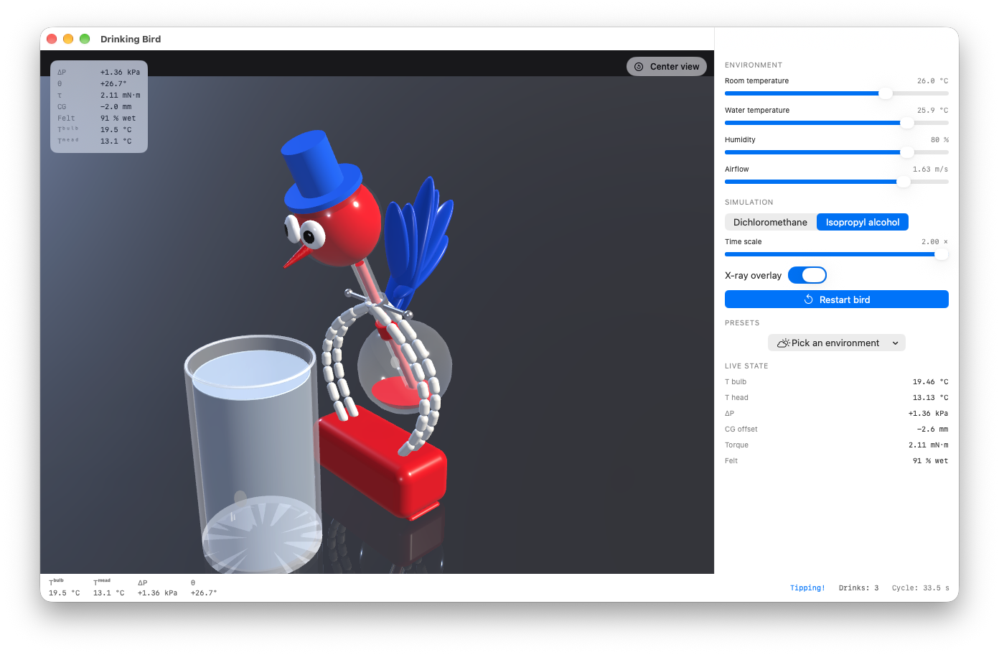

# Drinking Bird

A native macOS app that simulates the classic **drinking bird (dippy bird) heat engine** —
not a canned animation, but a real, integrated thermodynamic cycle rendered live in 3D.



## What it does

The app treats the toy as what it really is: a **heat engine** driven by evaporative cooling.

- **Evaporative cooling** of the wet felt head lowers the head-side vapor pressure
  (Clausius–Clapeyron saturation model).
- The pressure differential **pumps dye up the glass neck** against hydrostatic load;
  when the tube fills, liquid overflows into the head.
- A **rigid-body pendulum** about the leg pivot (torque computed from the live mass
  distribution, including the liquid that has moved) makes the bird tip once the
  head-heavy state crosses equilibrium.
- The beak pins against the glass, **rewets the felt** (the toy's actual reset step),
  opens the **vapor bypass** so pressure equalizes through the tube, and the head
  drains — the cycle repeats indefinitely.

Nothing is scripted. The typed phase machine
(warming up → rising → tipping → drinking → recovering) is *derived* from the physics
state every tick, never authoritative. Each cycle takes roughly 30–40 seconds with the
default settings, and no two cycles are exactly alike — the real toy drifts too.

## The 3D scene

- **Procedural SceneKit rendering** — the bird, glass, pedestal, and studio are built
  from code at runtime (no 3D asset files), resolution-independent from Retina to 4K.
- Drag anywhere to **orbit the camera**; the **Center view** button snaps the bird
  back to a centered, face-on framing.
- **X-ray overlay** shows ΔP, torque, center-of-gravity offset, and felt wetness in
  real units, overlaid on the live scene.
- The red liquid column in the neck, the liquid level in the bulb, pump bubbles,
  ripples, and the falling droplet are all driven by the physics state every frame.

## Build & run

```sh
brew install xcodegen        # once
xcodegen generate
open DrinkingBird.xcodeproj  # ⌘R
```

or from the CLI:

```sh
xcodebuild -project DrinkingBird.xcodeproj -scheme DrinkingBird -destination 'platform=macOS' build
xcodebuild -project DrinkingBird.xcodeproj -scheme DrinkingBird -destination 'platform=macOS' test
```

Requires macOS 13+ and Xcode with the macOS SDK. The app is sandboxed and network-free.

## Instrument panel

| Control | Effect |
|---|---|
| Room temperature | Warmer room → bigger bulb-side vapor pressure → faster cycles |
| Water temperature | Cold water supercharges evaporative cooling of the head |
| Humidity | High RH slows evaporation; near 100 % the toy stalls (and even this is physical) |
| Airflow | Breeze over the felt speeds the cycle |
| Fluid | Isopropyl alcohol (default) or dichloromethane — the "classic formula" |
| Time scale | 0.1–2× slow motion ↔ true seconds |
| X-ray overlay | ΔP, θ, torque, CG offset, felt wetness |
| Restart bird | Refills the liquid, rewets the felt, resets the counter |

Environment presets included: hot desert day, cold dry winter, Bahamas humid, and a
near-stall cellar.

## Architecture

```
DrinkingBird/
├── Domain/        # pure physics: engine, thermo, fluid, mechanics, geometry, dials
├── ViewModels/    # snapshot streaming from a background actor onto the main actor
└── Views/         # procedural 3D SceneKit rendering, instrument panel, HUD
DrinkingBirdTests/ # thermodynamic, transport, and full-cycle invariants
```

- The domain layer is a deterministic function
  `PhysicsState × Dials × Δt → PhysicsState` — same inputs, same bird.
- The engine advances in fixed 2 ms substeps on a background executor; the UI renders
  from published snapshots, decoupled from display rate.
- Real-world magnitudes throughout: the bird is ~18 cm tall, pressures in pascals,
  torques in mN·m, and the tipping angle is chosen so the beak tip lands exactly on
  the water surface at contact.

## Status

- [x] Physics engine (thermodynamics, fluid transport, mechanics) with multi-cycle soak
- [x] Procedural 3D scene with live state-driven animation
- [x] Instrument panel with dials, presets, restart, and x-ray overlay
- [x] 12 unit tests passing (thermo sanity, transport invariants, full cycles,
      stall behavior, mass conservation)
